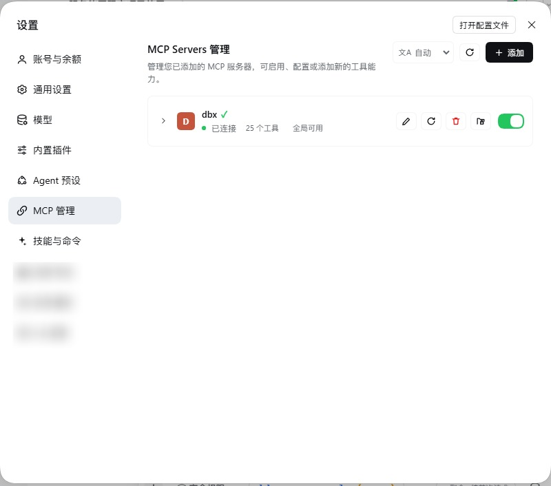
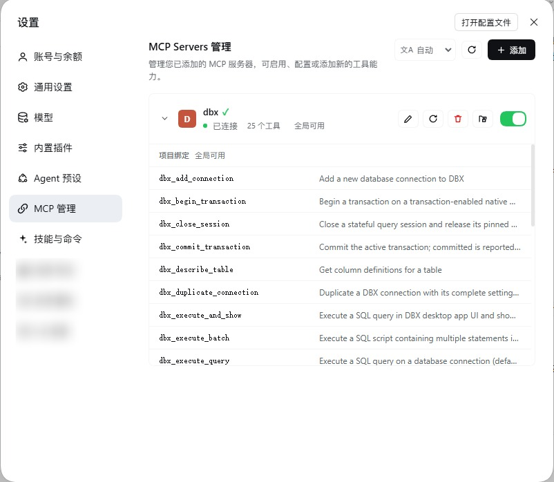
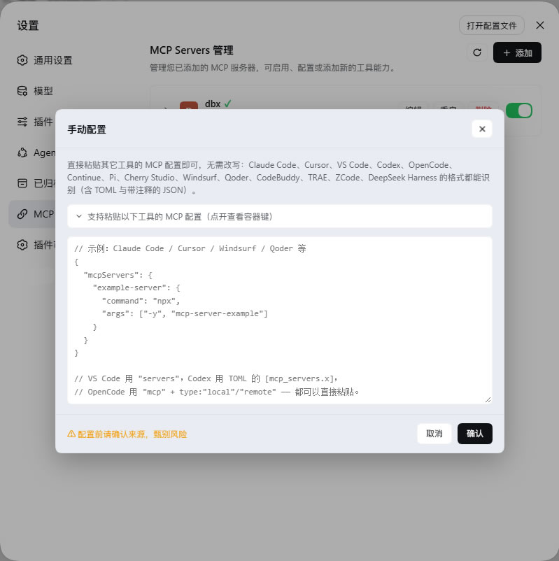
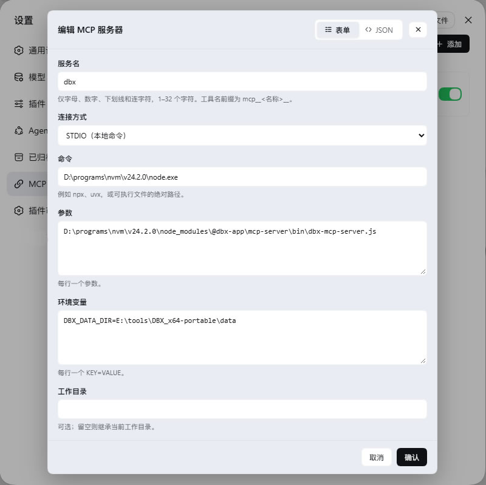
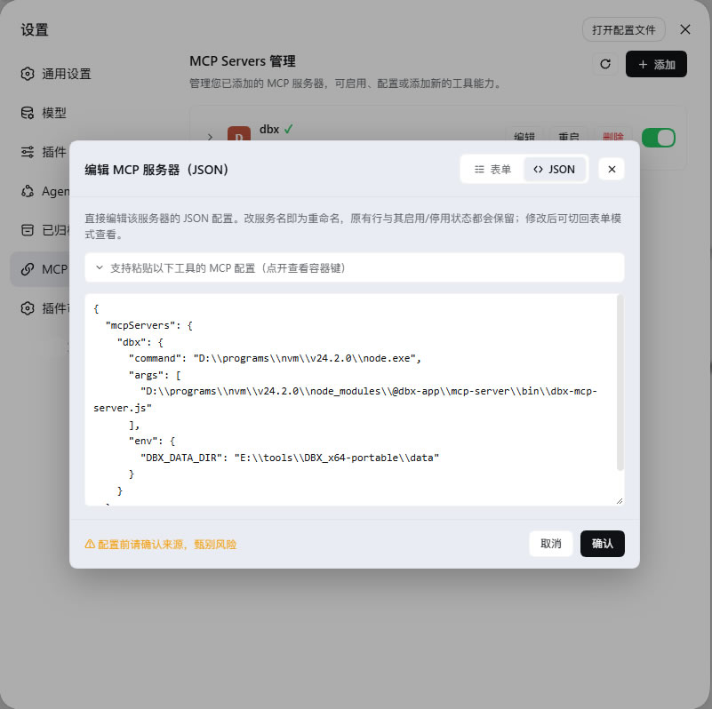

# dsh-mcp-manager-plus

English | [中文](README.md) | [Changelog](CHANGELOG.md)

An MCP server manager plugin for DeepSeek Harness: it adds an "MCP" page to the
settings sidebar, where you can inspect, enable/disable, edit, restart, delete
and add MCP servers — and **bind a server to specific project directories** so
that only those projects can use it.

Why this plugin exists:

- To manage MCP servers in DeepSeek Harness without ever opening a config file.
- Most MCP-related plugins on the plugin market target older DSH releases and
  simply do not work on current ones, so I had to write my own.

If this plugin stops working on a newer DSH release, please open an issue.

## Screenshots

**Settings → MCP**: the server list, connection state and enable/disable toggles.
Each row's edit / restart / delete / project-binding actions are icon buttons whose
labels appear on hover; the second line carries the connection state, the tool
count and the project-binding state.



**Expand a server**: every tool the server currently registers with the model,
with descriptions. An expanded row also opens with a project-binding summary
listing the directories it is restricted to.



**Add**: paste an MCP configuration from any tool — the format is detected
automatically (Codex's TOML and JSON-with-comments included).



**Edit · form mode**: edit field by field; switch to JSON mode at any time from
the dialog header.



**Edit · JSON mode**: opens pre-filled with the server's current configuration;
paste a whole replacement block, and renaming is just changing the name.



## Installation

**Requirements:** DSH >= 0.1.6-alpha.1 and < 0.3.0 (tested on 0.1.6-alpha.1, 0.2.0-rc.2 and 0.2.2-rc.1).
DSH itself needs Node.js >= 24.2.0 and Git >= 2.31.0.

### Option 1: one-click install from the plugin market

If you have [dshmarket](https://github.com/dsh-market/dsh-market) installed,
open **Settings → Plugin market**, search for `dsh-mcp-manager-plus`, and click
install.

### Option 2: command line

Pick any one of the three sources (`--profile web` installs into the `web`
profile; substitute your own profile name as needed):

```sh
# npm package (available once published)
dsh plugin --profile web add dsh-mcp-manager-plus

# GitHub repository
dsh plugin --profile web add https://github.com/appthin/dsh-mcp-manager-plus.git

# Local directory (clone this repository first; installed as a link, so edits
# take effect immediately — handy for development)
dsh plugin --profile web add <the cloned repository directory>
```

Restart dsh (or wait for the profile hot-reload); the page appears under
**Settings → MCP**.

### Verify

Open dsh web and go to **Settings → MCP** (the chain-link icon in the sidebar).
If the page does not show up, check in this order:

1. Switch to the latest Chrome/Edge — plugin bundles can fail to load on
   Chromium kernels older than 122;
2. Confirm it is installed into the profile you are actually running
   (`dsh plugin --profile web ls` lists the profile contents);
3. If the browser console shows errors, [open an issue](../../issues/new) with
   the message attached.

### Update & uninstall

```sh
dsh plugin --profile web ls                          # list installed plugins
dsh plugin --profile web add dsh-mcp-manager-plus    # update (re-adding installs the latest)
dsh plugin --profile web remove dsh-mcp-manager-plus # uninstall
```

With the plugin market installed, updates can also be done with one click on
its page. Uninstalling keeps the MCP server rows this plugin wrote into the
profile patch layer — that is your configuration data and will not be deleted.

## Features

| Capability | Description |
| --- | --- |
| List | Shows the MCP servers from the config file |
| Expand | Open a row to see every tool the server registers with the model, with descriptions |
| Enable / disable | Writes a `disabled` override into the patch layer; takes effect hot in ~1 s, no dsh restart |
| Edit | Two switchable modes: **form** (field by field) or **JSON** (one large textarea), see below |
| Restart | Destroys and re-initializes the server's connection in place (config unchanged); for recovering from dropped connections |
| Delete | Removes the server and all of its override rows from the config file |
| Icon actions | Each row's edit / restart / delete / project-binding actions are **icon buttons**; hovering (or reaching them with Tab) shows the label, which is also carried in `aria-label` for screen readers |
| Add | Paste an MCP configuration from **any mainstream tool**; the format is detected, and multiple servers per paste are supported (see table below) |
| Project binding | Restrict a server to a few project directories: sessions in other projects never see its tools and calls to them are refused. Takes effect on save, without touching the MCP connection (see below) |
| Bilingual | Chinese / English. Defaults to the harness UI language (falling back to the browser's language when unavailable); switch anytime from the page header — the choice is remembered, and host-side messages follow along |

## The server row

A row answers "how is this server doing right now", read left to right and top to
bottom:

```
⌄  [D]  dbx ✓
        ● Connected  25 tools  All projects
```

- **⌄** expands or collapses the server's tool list;
- the **square avatar** holds the server name's first letter, coloured from the
  name — a different name gets a different colour, which makes a long list
  scannable;
- **dbx ✓** is the server name; the check means it is enabled;
- the second line carries the **connection state** (Connected / Connecting /
  Pending / Failed / Unloading / Disabled), the **tool count**, and the **project-binding
  state** (`All projects`, or `Bound to N project(s)`). A bound row paints that
  chip's **text** green, and hovering it lists the bound directories;
- the far right is the **enable/disable switch**, preceded by up to four icon
  buttons (which ones a row has depends on what it can do, see the table):

| Icon | Action | Notes |
| --- | --- | --- |
| Pencil | Edit | Opens the edit dialog (form / JSON modes); only on rows from the config file |
| Circular arrow | Restart | Reconnects in place, configuration unchanged; shown only while the server is mounted |
| Bin (red) | Delete | Removes the row and its override rows from the config file; only on rows from the config file |
| Locked folder | Project binding | Opens the binding dialog; its outline turns green once bound. Shown whenever the row has a serverName |

The buttons are icons only, with their names in a hover tooltip. So that a mouse
is not required, the name is carried in three places: `aria-label` (the
accessible name), `title` (the native tooltip for touch and for anything that
ignores CSS), and `data-tip` (the tooltip the stylesheet paints immediately —
the native `title` waits about a second).

Deployment-provided and built-in rows cannot be edited or deleted, so they carry
only restart and project-binding, plus a source tag at the end of the second line
(`Deployment` / `Built-in`). **Servers you added yourself no longer show a
"Config file" style tag** — that slot now holds the more useful binding state.

## The two edit modes

When editing an existing server, the dialog header carries a **segmented
switch** (with icons and a sliding indicator, `radiogroup` semantics, arrow-key
navigable) to flip between modes at any time:

- **Form mode**: edit field by field (server name, transport, command, args,
  env, cwd, URL, headers).
- **JSON mode**: one large textarea that **opens pre-filled with the server's
  current configuration** (not an empty box or an example), so you can paste a
  whole replacement block — especially handy for configs copied from elsewhere.
  A collapsible format guide above the box lists the supported tools and their
  container keys, shared with the "Add" dialog.

Both modes write to the same row, therefore:

- **Renaming in JSON mode renames the row**: it keeps the original `id` and its
  enable/disable overrides instead of creating a duplicate;
- JSON mode supports every import format (Codex's TOML included), since format
  parsing is independent of add-vs-edit;
- A paste containing **multiple** servers is rejected with their names listed,
  avoiding the "which one actually got saved?" ambiguity;
- Switching back to form mode reads the row from disk, so half-edited JSON
  never leaks across modes.

> JSON mode exists only for **existing** servers: saving JSON means "update the
> named row", which needs a row name. New servers go through "Add", which is
> already JSON mode.

The container-key table in the format guide (`FORMAT_ROWS`) must agree with the
parser or the guide would lie — a test in `test/client.test.mjs` cross-checks
both: every key in the table must actually parse, and all 14 tool names the
parser supports must appear in the table.

## Supported import formats

Paste as-is; the plugin recognizes container keys, field names and file syntax:

| Tool | Container key | stdio | Remote | Notes |
| --- | --- | --- | --- | --- |
| Claude Code · Cursor · Windsurf · Qoder · Cherry Studio · CodeBuddy · TRAE · ZCode | `mcpServers` | `command`/`args` | `url`/`headers` | the standard format |
| DeepSeek Harness (this plugin itself) | `mcpServers` | `command`/`args` | `url`/`headers` | native format |
| VS Code | **`servers`** | `command`/`args` | `type:"http"` + `url` | different outer key |
| Codex | `mcp_servers` | `command`/`args` | `url` | **TOML**, not JSON |
| OpenCode | `mcp` | `type:"local"`, **command is an array** | `type:"remote"` + `url` | most divergent shape |
| Continue | `mcpServers` **array** | `command`/`args` | — | name lives inside each entry |
| Pi | `mcpServers` + `settings` | `command`/`args` | `transport:"streamable-http"` | `settings` is ignored |

These variations are also handled:

- **TOML input**: Codex's `config.toml` can be pasted directly (including
  nested `[…​.env]` tables and inline comments).
- **JSON comments and trailing commas**: docs for several tools carry `//`,
  `/* */` and trailing commas — all parse fine.
- **`type:"sse"`** maps onto this plugin's streamable-http transport.
- **`serverUrl`** (Windsurf's remote spelling), **`http_headers`** (Codex) and
  **command arrays** (OpenCode) are all filed correctly.
- **Unknown fields** such as `enabled`, `lifecycle` or `description` never fail
  an import; they are just not written to the config.

The import reports the detected source, e.g. `已识别 Codex 配置；新增 xxx`
("Codex configuration detected; added xxx"). A single failing entry is skipped
and listed with its reason, so one bad block does not waste the whole paste.

## Where the config lives

The plugin's single source of truth is the current profile's user patch layer:

```
$DSH_HOME/profiles/<profile>/cordis.patch.yml
```

Adding an MCP server appends one loader patch entry to that file:

```yaml
- insert:
    - id: mcp-github
      name: '@deepseek-ai/dsh-mcp-client'
      config:
        serverName: github
        transport: stdio
        command: npx
        args: ["-y", "@modelcontextprotocol/server-github"]
        env:
          GITHUB_TOKEN: "…"
```

Disabling writes a sibling override row instead:

```yaml
- id: mcp-github
  disabled: true
```

Because the profile runs with `patchReload: live`, the loader re-orchestrates
the plugin tree within about a second of each save, so config changes are both
**persistent and hot-effective** — the plugin never mutates the running loader
tree; it only writes the file, then the browser briefly polls to observe the
converged state.

## Project binding

MCP servers are globally available to the whole DSH instance by default. If you
want a server to exist in **one project only**, click the **locked-folder icon**
at the right of its row (its tooltip reads "Project binding") and list one
absolute project directory per line:

```
D:\work\my-project
~/work/another-project
```

Once saved:

- Only sessions whose **working directory is one of those directories (or inside
  one)** can see and call its tools;
- In every other project its tools **do not appear in the tool list at all**
  (they are filtered per session), and even if a model insists on a name, the
  call is refused before execution with a message naming the bound directories;
- Sessions that are already open are re-evaluated immediately — no dsh restart,
  and the MCP connection itself is never touched;
- An existing binding can be changed at any time by clicking that icon again; the
  dialog opens pre-filled with its current paths;
- Clearing every path **removes the binding**, returning the server to
  "available everywhere".

Matching rules (`pathKey` / `isWithin` in `lib/index.js`):

- Only **absolute paths** are accepted; `~` expands to the current user's home
  directory. A relative path is refused with a reason;
- On Windows matching is case-insensitive, `/` and `\` are equivalent, and a
  trailing separator is optional;
- The test is "is it this directory, or below it", so binding `E:\work\alpha`
  does **not** let the name-prefix sibling `E:\work\alphabeta` through.

Bindings live in **this plugin's own file**, not in the patch layer:

```
$DSH_HOME/profiles/<profile>/plugin-data/dsh-mcp-manager-plus/bindings.json
```

(override with the `DSH_MCP_MANAGER_BINDINGS` environment variable). Keeping them
out of the patch layer is deliberate: that layer composes the running plugin
tree, so a binding written there would remount every MCP connection on each
edit. Bindings are just plugin data, and an edit applies immediately in the
running process.

Deliberate limits, so you know what you are getting:

- **It is not a sandbox.** What it restricts is *which tools a model can see and
  call*. The MCP server process and its connection still exist (the config row
  remains global); only this session's visibility of, and access to, its tools
  is constrained.
- **When the working directory cannot be determined, nothing is blocked**
  (fail-open): better to miss a block than to lock a user out of their own
  project.
- **A damaged or missing `bindings.json` reads as "no bindings"**, i.e. back to
  globally available — one bad edit cannot make a server unusable everywhere.
- A binding is keyed by **serverName**, independent of the row's `id` in the
  patch layer; renaming the server (a new serverName) is a different server and
  must be bound again.

## Security model

- **Loopback only.** The API lives on the same loopback web server; non-loopback
  origins get a 403.
- **Validate before writing.** Every candidate file is re-parsed as a
  top-level loader patch array; a parse failure refuses the write, so one bad
  edit cannot break the next boot.
- **Nothing outside its jurisdiction.** The file is hand-written by users:
  comments, unrelated entries and unknown fields survive a rewrite untouched —
  only the one modified block is rewritten.
- **Secrets stay local.** Values whose keys look like
  `KEY|PASSWORD|SECRET|TOKEN` are masked on read, and unmasked again when the
  browser echoes them back; real secrets never appear on the page.
- **Bundle-provided servers are read-only.** Rows contributed by the bundle
  layer can be enabled/disabled but not edited or deleted.
- **Project bindings only ever hold local data.** The binding table is served by
  the same loopback API, accepts absolute paths only, and is re-parsed before
  writing; it never enters the patch layer, so editing a binding cannot affect
  how the plugin tree is composed.

## Development

```sh
node test/run.mjs          # all eight suites (149 assertions)
```

| Suite | Coverage |
| --- | --- |
| `test/patch.test.mjs` | patch-layer segmentation, parsing, validation, generation and byte-exact round-trips |
| `test/yaml.test.mjs` | the `js-yaml` compatibility layer: capability probing, skipping an incompatible copy, and `!!js` fidelity under the degraded parser |
| `test/import.test.mjs` | config formats of 14 tools, the TOML subset, JSON comments and trailing commas |
| `test/editjson.test.mjs` | JSON-mode editing: in-place updates, renames keeping id and overrides, multi-server rejection |
| `test/host.test.mjs` | every host-side HTTP route, driving the real `apply()` through a fake Cordis context; project-binding guard denials and per-session tool restrictions included |
| `test/client.test.mjs` | whether the shell can load the browser bundle and register the settings page; the mode switch, the icon buttons' three label carriers, and that the card does not clip its tooltips |
| `test/compose.test.mjs` | composing a real profile from the bundle layer, confirming this plugin's rows mount |
| `test/live.test.mjs` | read-only run against the real profile, confirming live configs read correctly with secrets masked |

The tests use no test framework — just Node's built-in `node:test` — and reuse
the `js-yaml` from the profile (the same parse path as the runtime, compatibility
layer in `lib/yaml.js` included).

> One case in `test/compose.test.mjs` composes the real profile's plugin tree and
> asserts that no two bundles insert the same row id. It reads the profile on
> **this machine**, so if two installed plugins collide on an id that case fails
> — that is a problem with your profile, not a regression in this plugin, and the
> failure names the colliding id.

### Layout

| File | Purpose |
| --- | --- |
| `lib/index.js` | host side: HTTP API, inventory projection, write operations, and project-binding storage plus enforcement |
| `lib/import.js` | import parsing: each tool's config format → this plugin's server shape |
| `lib/patch.js` | patch-layer read/write: segmentation, parsing, validation, generation |
| `lib/yaml.js` | `js-yaml` compatibility: capability probing, skipping an incompatible copy, and a degraded parser when no copy can carry the custom type |
| `lib/client.js` | browser side: the settings page UI (hand-written lazy-CJS bundle, no build step) |
| `cordis.patch.yml` | the bundle patch inserting this plugin into the profile's layer stack |

### Helper scripts

| Script | Purpose |
| --- | --- |
| `node tools/e2e-import.mjs` | boots a real host and POSTs each of the 14 tool formats to `/import`, then validates the written patch rows |
| `node tools/roundtrip-json.mjs` | verifies the JSON editor's pre-filled config round-trips byte-for-byte (confirming unchanged content drops no fields) |
| `node tools/check-client-bundle.mjs` | loads the client bundle the way the shell does and checks the registration result and nav-icon CSS |
| `node tools/check-segmented.mjs` | checks the segmented switch's slider geometry (inset, half-width, offset) against the track assumptions |
| `node tools/preview-edit-modes.mjs` | renders both edit-dialog modes with the real components into `edit-modes-preview.html` |
| `node tools/preview-row.mjs` | renders every shape of server row (user / bundle / builtin / disabled / bound / expanded) into `row-preview.html` |
| `node tools/preview-actions.mjs` | renders each icon button with its tooltip, one at a time and at 3×, into `actions-preview.html` |
| `node tools/preview-tips.mjs` | checks that a tooltip escapes the card, that the last button's tip stays right-aligned, and that the bottom corners survive without `overflow:hidden`, into `tips-preview.html` |
| `node tools/check-nav-icon.mjs` | checks that the nav icon's mask payload is a drawable 16×16 template |
| `node tools/gen-icon-preview.cjs` | extracts icons from the dsh web bundle into the `icon-options.html` comparison page |
| `node tools/dump-icon.cjs <IconName>` | prints an icon's SVG path for hand-written overrides |
| `node tools/verify-release.mjs [version]` | post-publish verification: the registry serves the version, a fresh install pulled its own `js-yaml`, and both halves of the "profile hoists a v5" scenario; `--sync-mirror` also waits for the npmmirror mirror |

## License

MIT
