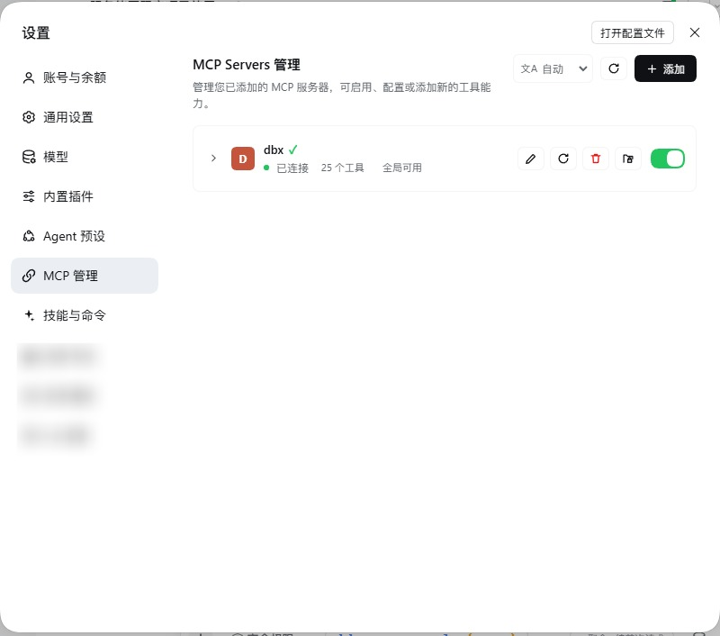
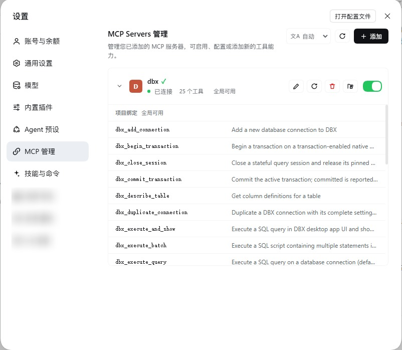
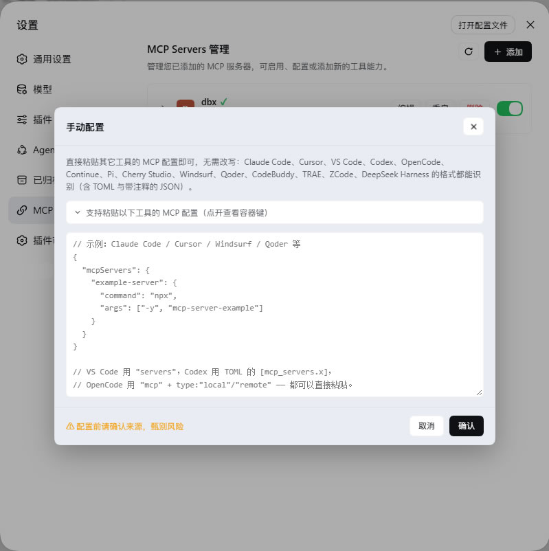
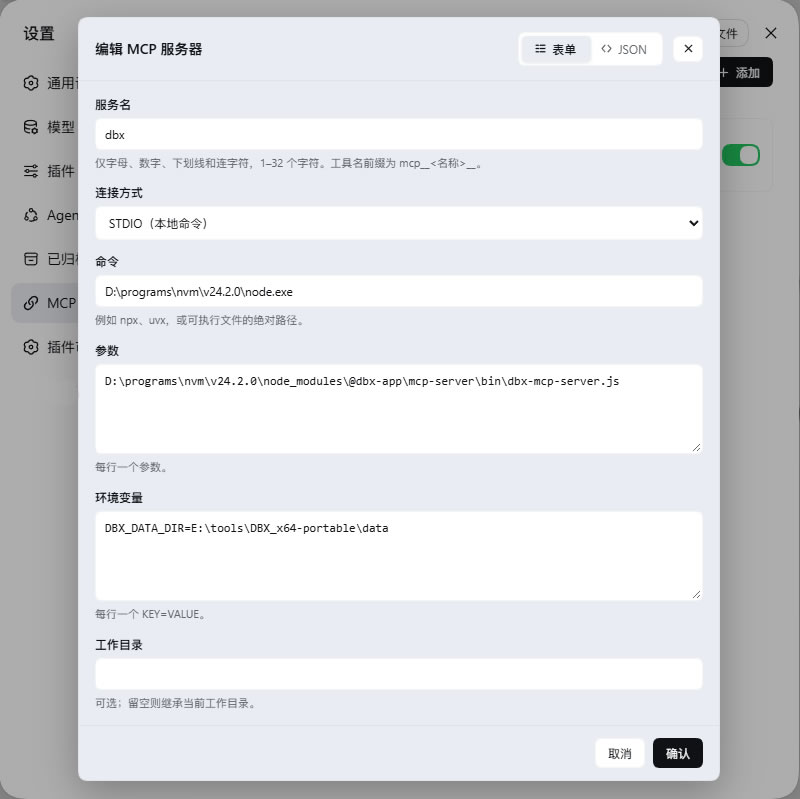
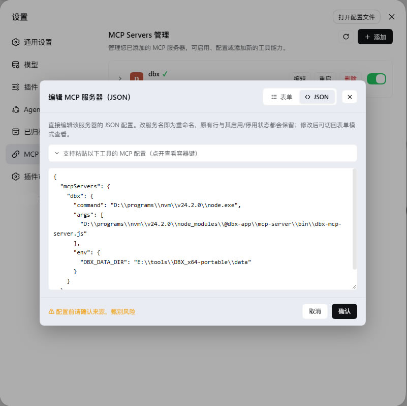

# dsh-mcp-manager-plus

[English](README.en.md) | 中文 | [更新日志](CHANGELOG.md)

MCP 服务器管理插件：在 DeepSeek Harness 设置界面的左侧边栏新增「MCP 管理」页面，
可直接查看、启用/停用、编辑、重启、删除与添加 MCP 服务器，
也可以把某个服务器**绑定到指定项目目录**，让它只在那些项目里可用。

为什么要开发这个插件？
- 为了方便管理 DeepSeek Harness 中的 MCP 服务器，无需打开配置文件。
- 插件市场中的其他MCP插件大多都是支持以前旧版本的DSH，安装在新版DSH上根本没法使用，我不得不自己写一个。

如果你发现本插件在新版DSH上无法正常工作，请提交一个 issue。

## 截图

**设置 → MCP 管理**：服务器列表、连接状态与启停开关。每行的编辑 / 重启 / 删除 /
项目绑定都是图标按钮，悬停显示名称；第二行依次是连接状态、工具数、以及项目绑定状态。



**展开服务器**：查看该服务器当前注册到模型的全部工具及描述；展开后顶部还会有一条
项目绑定摘要，列出它被限定在哪些目录。



**添加**：直接粘贴任意工具的 MCP 配置，自动识别格式（含 Codex 的 TOML 与带注释的 JSON）。



**编辑 · 表单模式**：逐字段修改，弹窗顶部可随时切换到 JSON 模式。



**编辑 · JSON 模式**：打开即预填该服务器当前配置，可整段粘贴替换；改服务名即为重命名。



## 安装说明

**版本要求：** DSH >= 0.1.6-alpha.1 且 < 0.3.0（已在 0.1.6-alpha.1、0.2.0-rc.2 与 0.2.2-rc.1 上测试）。DSH 自身依赖 Node.js >= 24.2.0 与 Git >= 2.31.0。

### 方式一：插件市场一键安装

已安装 [dshmarket](https://github.com/dsh-market/dsh-market) 的话，打开 **设置 → 插件市场**，
搜索 `dsh-mcp-manager-plus`，点一下安装即可。

### 方式二：命令行安装

三种来源任选其一（`--profile web` 表示装进 `web` profile，其他 profile 同理替换）：

```sh
# npm 包（发布后可用）
dsh plugin --profile web add dsh-mcp-manager-plus

# GitHub 仓库
dsh plugin --profile web add https://github.com/appthin/dsh-mcp-manager-plus.git

# 本地目录（先把仓库 clone 到本地；以 link 方式安装，改动即时生效，适合开发调试）
dsh plugin --profile web add <clone 下来的本仓库目录>
```

随后重启 dsh（或等待 profile 热重载），在「设置 → MCP 管理」即可看到页面。

### 验证

打开 dsh web，进入 **设置 → MCP 管理**（侧边栏链条图标的那一项）。
页面没有出现时的排查顺序：

1. 换最新版 Chrome/Edge —— 部分插件的 bundle 在 Chromium 122 以下的内核会加载失败；
2. 确认装进了正在使用的 profile（`dsh plugin --profile web ls` 查看清单）；
3. 浏览器控制台有报错时，附上报错内容[提交 issue](../../issues/new)。

### 更新与卸载

```sh
dsh plugin --profile web ls                          # 查看已装插件
dsh plugin --profile web add dsh-mcp-manager-plus    # 更新（重新 add 即覆盖为最新版）
dsh plugin --profile web remove dsh-mcp-manager-plus # 卸载
```

装有插件市场时，更新也可以在市场页一键完成。卸载后 profile 补丁层里由本插件写入的
MCP 服务器行会原样保留——它们是你的配置数据，不会被连带删除。

## 功能

| 能力 | 说明 |
| --- | --- |
| 列表 | 展示配置文件中的 MCP 服务器 |
| 展开 | 点开一行查看该服务器当前注册到模型的所有工具及其描述 |
| 启用 / 停用 | 写入补丁层的 `disabled` 覆盖，约 1 秒内热生效，无需重启 dsh |
| 编辑 | 两种模式可随时切换：**表单**（逐字段）或 **JSON**（大输入框），见下节 |
| 重启 | 就地销毁并重新初始化该服务器的连接（配置不变），用于连接中断后恢复 |
| 删除 | 从配置文件中移除该服务器及其所有覆盖行 |
| 图标操作 | 每行的编辑 / 重启 / 删除 / 项目绑定都是**图标按钮**，鼠标移上去（或键盘 Tab 聚焦）显示文字提示；名称同时写在 `aria-label` 里，读屏能读到 |
| 添加 | 粘贴**任意主流工具**的 MCP 配置即可，自动识别格式，支持一次导入多个（见下表） |
| 项目绑定 | 把某个服务器限定在几个项目目录里：其它项目的会话看不到它的工具，硬调也会被拒绝；保存即生效，不动 MCP 连接（见下节） |
| 多语言 | 中文 / English。默认跟随界面语言（取不到时按浏览器语言探测），页面右上角可随时切换并记住选择；宿主端的错误与提示文案同样跟随 |

## 服务器行

一行里放的是「这台服务器现在怎么样」，从上到下、从左到右：

```
⌄  [D]  dbx ✓
        ● 已连接  25 个工具  全局可用
```

- **⌄** 展开 / 收起该服务器的工具列表；
- **方头像**里是服务名的首字母，颜色由服务名决定，换一个名字换一种颜色，便于扫视；
- **dbx ✓** 是服务名，后面那个勾表示已启用（连接已确认断开时不画这个勾，见下）；
- 第二行依次是**连接状态**（已连接 / 连接中 / 重连中 / 等待中 / 连接失败 /
  已断开 / 缺少凭据 / 可能未连接 / 卸载中 / 已停用）、**工具数**、以及
  **项目绑定状态**（`全局可用` 或 `仅限 N 个项目`）。
  已绑定时这个标签的**文字**会变成绿色，鼠标悬停可直接看到绑定的目录；
- 状态徽章读的是 **MCP 握手结果**，不是「插件条目挂载成功」。进程没起来、
  握手失败、鉴权失败都发生在条目加载之后，条目本身一直是 `active`，所以
  只按条目判断会出现「已连接 · 0 个工具」这种自相矛盾的行（
  [#6](https://github.com/appthin/dsh-mcp-manager-plus/issues/6)）。现在的取值顺序是：
  1. 能读到 `dsh-mcp-client` 的连接状态就用它：`failed` → 连接失败、
     `closed` → 已断开、`connecting` / `reconnecting` → 连接中 / 重连中、
     `waiting-credentials` → 缺少凭据、`connected` → 已连接；
  2. 读不到时，**已启用、已挂载、但工具数为 0** 的行降级为「可能未连接」
     （黄点），不再声称已连接；有工具的行不加这个字段，因为工具已注册本身
     就证明握手成功过。
  失败原因（`spawn ENOENT` 之类）与重连进度写在徽章的悬停提示里。
- 行的最右边是**启用开关**；开关左边最多四个图标按钮（取决于该行能做什么，见下表）：

| 图标 | 动作 | 说明 |
| --- | --- | --- |
| 铅笔 | 编辑 | 打开编辑弹窗（表单 / JSON 两种模式）；仅出现在配置文件里的行 |
| 圆箭头 | 重启 | 就地重连，配置不变；仅在该服务器已挂载时出现 |
| 垃圾桶（红） | 删除 | 从配置文件移除该行及其覆盖行；仅出现在配置文件里的行 |
| 带锁文件夹 | 项目绑定 | 打开项目绑定弹窗；已绑定时描边变绿。只要该行有 serverName 就出现 |

按钮只画图标，名称在悬停提示里。为了不只依赖鼠标，名称同时写在三个地方：
`aria-label`（读屏用的无障碍名称）、`title`（触控与不支持 CSS 时的原生提示）、
`data-tip`（样式表画的即时气泡，原生 `title` 要等约一秒才出来）。

部署内置与内置能力的行不能编辑或删除，所以它们只有重启与项目绑定两个按钮，
并在第二行末尾多一个来源标签（`部署内置` / `内置能力`）——**你自己添加的服务器
不再显示「配置文件」这类来源标签**，那个位置留给了更有用的绑定状态。

## 编辑时的两种模式

编辑已有服务器时，弹窗标题右侧有一个**分段开关**（带图标、带滑动指示块，`radiogroup` 语义，
支持左右方向键），随时可来回切换：

- **表单模式**：逐字段编辑（服务名、连接方式、命令、参数、环境变量、工作目录、URL、请求头）。
- **JSON 模式**：一个大输入框，**打开时已填入该服务器当前的配置**（而不是空框或示例），
  可以直接整段替换粘贴 —— 粘贴别处复制来的配置片段尤其方便。
  框上方有一份**可折叠的格式说明**，列出支持哪些工具、各自的容器键是什么，
  与「添加」弹窗共用同一个组件。

两种模式最终都写入同一行，因此：

- JSON 里**改服务名即为重命名**，该行会保留原来的 `id` 与启用/停用覆盖，不会多出一个副本；
- JSON 模式同样支持全部导入格式（含 Codex 的 TOML），因为格式解析与编辑/新增无关；
- 一次粘贴里出现**多个**服务器时会被拒绝并列出名字，避免「到底保存了哪个」的歧义；
- 切回表单模式时以磁盘上的行为准，不会带过去 JSON 框里改了一半的内容。

> 只有**已存在**的服务器才有 JSON 模式：JSON 保存是「更新指定的一行」，需要一个行名。
> 新增走「添加」按钮，它本来就是 JSON 模式。

格式说明里的容器键表（`FORMAT_ROWS`）与解析器必须一致，否则说明就是错的 ——
`test/client.test.mjs` 有一条测试把两边对起来验：表里每个键都真的能被解析，
解析器支持的 14 个工具名也都必须出现在表里。

## 支持导入的配置格式

粘贴时不需要改写，插件会识别容器键、字段名与文件语法：

| 工具 | 容器键 | stdio | 远程 | 备注 |
| --- | --- | --- | --- | --- |
| Claude Code · Cursor · Windsurf · Qoder · Cherry Studio · CodeBuddy · TRAE · ZCode | `mcpServers` | `command`/`args` | `url`/`headers` | 标准格式 |
| DeepSeek Harness（本插件自身） | `mcpServers` | `command`/`args` | `url`/`headers` | 原生格式 |
| VS Code | **`servers`** | `command`/`args` | `type:"http"` + `url` | 外层键不同 |
| Codex | `mcp_servers` | `command`/`args` | `url` | **TOML**，不是 JSON |
| OpenCode | `mcp` | `type:"local"`，**command 是数组** | `type:"remote"` + `url` | 结构差异最大 |
| Continue | `mcpServers` **数组** | `command`/`args` | — | 名字在条目里 |
| Pi | `mcpServers` + `settings` | `command`/`args` | `transport:"streamable-http"` | `settings` 会被忽略 |

另外还兼容这些差异：

- **TOML 输入**：Codex 的 `config.toml` 直接粘贴即可（含嵌套的 `[…​.env]` 表与行内注释）。
- **JSON 注释与尾逗号**：多个工具的文档示例带 `//`、`/* */` 和尾逗号，均可解析。
- **`type:"sse"`**：映射到本插件的 streamable-http 传输。
- **`serverUrl`**（Windsurf 的远程写法）、**`http_headers`**（Codex）、**command 数组**（OpenCode）
  都会被正确归位。
- **未知字段**：如 `enabled`、`lifecycle`、`description` 等不会导致导入失败，只是不写入配置。

导入时会报出识别到的来源，例如 `已识别 Codex 配置；新增 xxx`；单条失败只跳过该条，
并把它和失败原因一并列出，不会让整段粘贴白费。

## 配置写在哪里

插件的「唯一真相」是当前 profile 的用户补丁层：

```
$DSH_HOME/profiles/<profile>/cordis.patch.yml
```

新增一个 MCP 服务器就是向该文件追加一行 loader patch entry：

```yaml
- insert:
    - id: mcp-github
      name: '@deepseek-ai/dsh-mcp-client'
      config:
        serverName: github
        transport: stdio
        command: npx
        args: ["-y", "@modelcontextprotocol/server-github"]
        env:
          GITHUB_TOKEN: "…"
```

停用则是同级的 `disabled` 覆盖行：

```yaml
- id: mcp-github
  disabled: true
```

因为 profile 使用 `patchReload: live`，保存后 loader 会在约 1 秒内重新编排插件树，
所以配置改动**既是持久化的，也是热生效的** —— 插件本身不改动运行中的 loader 树，
只写文件，然后由浏览器端短暂轮询观察收敛后的实际状态。

## 项目绑定

MCP 服务器默认在整个 DSH 实例里全局可用。如果你希望某个服务器**只在某个项目里
出现**，点该行最右边那个**带锁文件夹图标**（悬停提示「项目绑定」），每行填一个
项目目录的绝对路径：

```
D:\work\my-project
~/work/another-project
```

保存后：

- 只有**工作目录落在这几个目录里（含其子目录）的会话**能看到并调用它的工具；
- 其它项目的会话里，它的工具**不出现在工具列表里**（被按会话过滤掉了），
  即使模型硬报一个名字，调用也会在执行前被拒绝，并说明它被绑定到了哪些目录；
- 已经开着的会话也会被立即重新判定，不需要重启 dsh，也不动 MCP 连接本身；
- 已有服务器的绑定**随时可改**：再点一次那个图标即可，弹窗里预填当前路径；
- 清空全部路径即为**解除绑定**，它又回到「全局可用」。

匹配规则（`lib/index.js` 的 `pathKey` / `isWithin`）：

- 只认**绝对路径**；`~` 会展开成当前用户的主目录。相对路径会被拒绝并提示原因；
- Windows 下大小写不敏感，`/` 与 `\` 等价，结尾的分隔符可有可无；
- 判断的是「就是它，或在它下面」，所以绑定 `E:\work\alpha` **不会**放过
  名字只差一个前缀的兄弟目录 `E:\work\alphabeta`。

绑定数据存在**本插件自己的文件**里，而不是补丁层：

```
$DSH_HOME/profiles/<profile>/plugin-data/dsh-mcp-manager-plus/bindings.json
```

（可用环境变量 `DSH_MCP_MANAGER_BINDINGS` 指向别处。）刻意不写进补丁层，是因为补丁层
决定运行中的插件树 —— 把绑定写进去意味着每改一次绑定就要重新编排整棵树、重挂所有
MCP 连接；而绑定只是本插件的数据，改完在运行中的进程里立刻生效。

有意的边界，请知悉：

- **它不是沙箱**，挡的是「模型能看到并调用的工具」。MCP 服务器进程与连接照常存在
  （配置行仍是全局的），被限制的是这个会话对它的工具可见性与调用权。
- **工作目录判断不出来时不拦截**（宁可不拦，也不误伤）：宁可少拦一次，也不要把
  用户挡在自己项目之外。
- **`bindings.json` 损坏或缺失时按「没有绑定」处理**，即回到全局可用 ——
  一次坏编辑不会让服务器在所有项目里都用不了。
- 绑定按 **serverName** 记录，与该行在补丁层里的 `id` 无关；改名（换 serverName）
  等于换了一个服务器，需要重新绑定。

## 安全约定

- **只响应本机请求。** API 挂在同一个 loopback web server 上，非 loopback 来源直接 403。
- **写入前必校验。** 每份候选文件都会重新解析为「顶层 loader patch 数组」，
  解析失败则拒绝写入，因此一次错误编辑不会让下次启动失败。
- **不碰不归它管的内容。** 文件是用户手写的：注释、无关条目、未知字段在改写后原样保留，
  只重写被改动的那一个块。
- **凭据不外传。** 形如 `KEY|PASSWORD|SECRET|TOKEN` 的配置值在读取时被掩码，
  浏览器回传掩码时再从原值还原，真实密钥不会出现在页面里。
- **部署内置的服务器只读。** 由 bundle 层提供的行可以停用/启用，但不能编辑或删除。
- **项目绑定只收本机数据。** 绑定表由同一个 loopback API 读写，同样只接受绝对路径，
  写入前重解析；它不写入补丁层，因此不会因为一次绑定编辑而影响插件树的编排。

## 开发

```sh
node test/run.mjs          # 全部八个测试套件（共 149 项）
```

| 套件 | 覆盖范围 |
| --- | --- |
| `test/patch.test.mjs` | 补丁层分段、解析、校验、生成与逐字节往返 |
| `test/yaml.test.mjs` | `js-yaml` 兼容层：能力探测、跳过硬编码不兼容的副本、降级解析下 `!!js` 的语义保真 |
| `test/import.test.mjs` | 14 种工具的配置格式、TOML 子集、JSON 注释与尾逗号 |
| `test/editjson.test.mjs` | JSON 模式编辑：原地更新、重命名保留 id 与覆盖、多条拒绝 |
| `test/host.test.mjs` | 宿主端全部 HTTP 路由，用假的 Cordis 上下文驱动真实 `apply()`；含项目绑定的守卫拦截与按会话工具限制 |
| `test/client.test.mjs` | 浏览器 bundle 能否被 shell 加载并注册设置页；含模式开关、图标按钮的三处标签载体、卡片不裁切提示 |
| `test/compose.test.mjs` | 用真实的 bundle 层组合 profile，确认本插件的行能挂载 |
| `test/live.test.mjs` | 只读地跑真实 profile，确认线上配置能被正确读出且凭据已掩码 |

测试不依赖任何测试框架，只用 Node 内置的 `node:test`，并复用 profile 中已有的
`js-yaml`（与运行时同一条解析路径，含 `lib/yaml.js` 的兼容层）。

> `test/compose.test.mjs` 里有一条用例会拿真实的 profile 组合出插件树，然后检查
> 没有两个 bundle 插入了同一个行 id。它读的是**当前机器上的 profile**，所以如果
> 你装的某个插件与另一个撞了 id，这条会失败——那是那套 profile 的问题，不是本插件
> 的回归，报错里会直接给出撞车的 id。

### 结构

| 文件 | 作用 |
| --- | --- |
| `lib/index.js` | 宿主端：HTTP API、清单投影、写操作、项目绑定的读写与执行 |
| `lib/import.js` | 导入解析：各工具配置格式 → 本插件的服务器形状 |
| `lib/patch.js` | 补丁层读写：分段、解析、校验、生成 |
| `lib/yaml.js` | `js-yaml` 兼容层：副本能力探测、跳过硬编码不兼容的副本、无自定义类型时的降级解析 |
| `lib/client.js` | 浏览器端：设置页面 UI（手写 lazy-CJS bundle，无构建步骤） |
| `cordis.patch.yml` | bundle 补丁，把本插件插入 profile 的层栈 |

### 辅助脚本

| 脚本 | 作用 |
| --- | --- |
| `node tools/e2e-import.mjs` | 起真实宿主端，把 14 种工具的配置逐个 POST 到 `/import`，再校验写出的补丁行 |
| `node tools/roundtrip-json.mjs` | 校验 JSON 模式预填的配置能原样往返（不改任何内容点确认不会丢字段） |
| `node tools/check-client-bundle.mjs` | 按 shell 的方式加载客户端 bundle，检查注册结果与导航图标 CSS |
| `node tools/check-segmented.mjs` | 校验分段开关的滑块几何（内缩、半宽、位移）与轨道假设一致 |
| `node tools/preview-edit-modes.mjs` | 用真实组件渲染编辑弹窗的两种模式，生成 `edit-modes-preview.html` |
| `node tools/preview-row.mjs` | 用真实组件渲染服务器行的各种形态（用户行 / 内置行 / 停用行 / 已绑定 / 展开），生成 `row-preview.html` |
| `node tools/preview-actions.mjs` | 逐个渲染图标按钮与它的悬停提示（含 3× 放大），生成 `actions-preview.html` |
| `node tools/preview-tips.mjs` | 验证提示不被卡片裁切、最后一个按钮的提示右对齐、去掉 `overflow:hidden` 后底部圆角仍在，生成 `tips-preview.html` |
| `node tools/check-nav-icon.mjs` | 校验导航图标的 mask 载荷是合法可绘制的 16×16 模板 |
| `node tools/gen-icon-preview.cjs` | 从 dsh 前端 bundle 提取图标，生成 `icon-options.html` 对照页 |
| `node tools/dump-icon.cjs <IconName>` | 打印某个内置图标的 SVG 路径，便于手写覆盖 |
| `node tools/verify-release.mjs [版本]` | 发布后验证：registry 是否有该版本、全新安装是否带上了自己的 `js-yaml`、以及「profile 顶层被换成 v5」的两种情形；`--sync-mirror` 顺带等 npmmirror 同步 |

## License

MIT
